# Parley

**Parley is a subscription web app that teaches parents to answer their ex calmly, for parents in a custody fight.**

Every text to your ex can end up in court. Parley teaches parents to stay calm and keeps a dated record for the lawyer.

**Live:** https://parley.adiletfndr.com · no sign-up, works on a phone or a laptop
**Track:** Skills · B2C · web · Business Cup 2.0 (Zimran case)


---

## Try it in 3 minutes

1. Open **parley.adiletfndr.com** and press **Get my plan**.
2. Answer the quiz (about a minute). You get your starting point and a 28-day plan.
3. Pay with the test card **4242 4242 4242 4242**, any future date, any CVC. No real money moves.
4. Do **Day 1** of the course. It is a short chat.
5. Open **Reply**, pick one of the sample screenshots, press **Calm it down**.
6. Open **Record**, press **Upload screenshots** → **WhatsApp export** → **Try a sample export**. Then press **PDF**.

Want to see the course further along without waiting days? **/demo** opens a sample case on day 12, with a clock to jump +7 or +17 days and a preview button on every locked day.

### Sample files

All made up, no real people. They are already inside the app as one-tap samples, and here if you want to upload them yourself.

| File | What it is |
|---|---|
| [late-pickup.png](public/samples/late-pickup.png) | "ur seriously 40 min late AGAIN", iMessage |
| [soccer-money.png](public/samples/soccer-money.png) | a fight about who pays for soccer |
| [new-partner.png](public/samples/new-partner.png) | a new partner at pickup, WhatsApp |
| [weekend-threat.png](public/samples/weekend-threat.png) | "im keeping them this weekend" |
| [fever.png](public/samples/fever.png) | a 102 fever and an accusation, WhatsApp |
| [friendly-hi.png](public/samples/friendly-hi.png) | a friendly message, to show it doesn't invent drama |
| [whatsapp-export.txt](public/samples/whatsapp-export.txt) | a WhatsApp "Export chat" file, 13 messages |

---

## How we sell: a 1-minute quiz, then a 28-day course

Eight qualifying questions (who they are, how tense it gets, what sets it off, where the case stands), a skill check on real-looking texts, their own plan, then a hard paywall. This is the funnel Zimran's apps use.

<table>
<tr>
<td width="25%">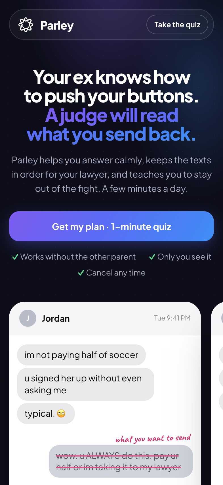</td>
<td width="25%">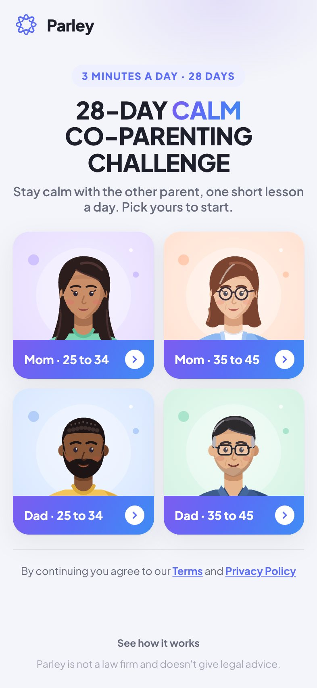</td>
<td width="25%">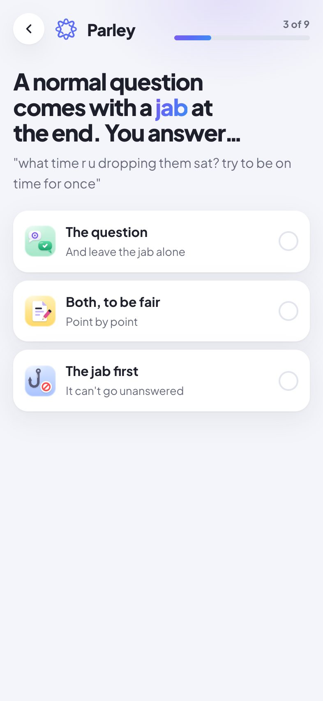</td>
<td width="25%">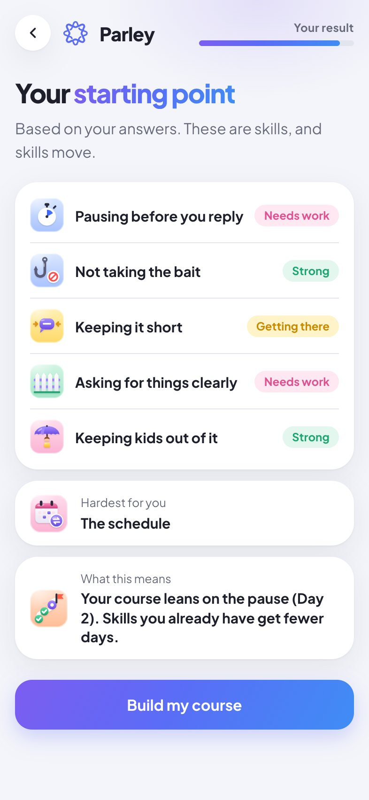</td>
</tr>
<tr>
<td>Landing: real-looking chats, what you want to send vs what you send instead</td>
<td>Pick yours: Mom or Dad, by age</td>
<td>Skill check: how would you answer this?</td>
<td>Your starting point, in words, never a score</td>
</tr>
<tr>
<td>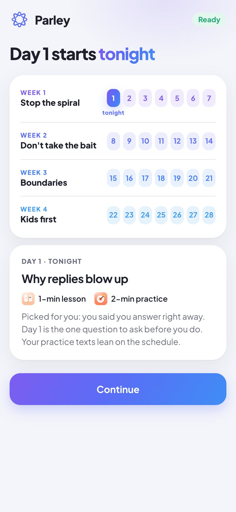</td>
<td>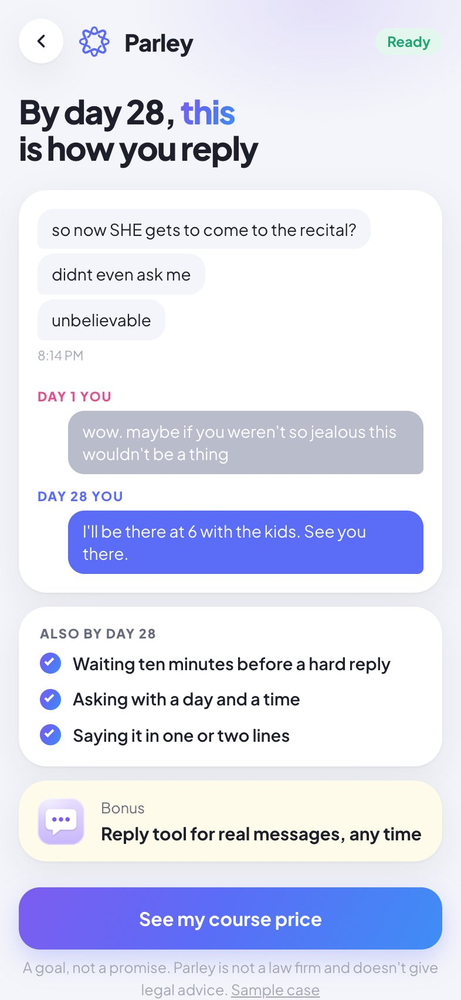</td>
<td>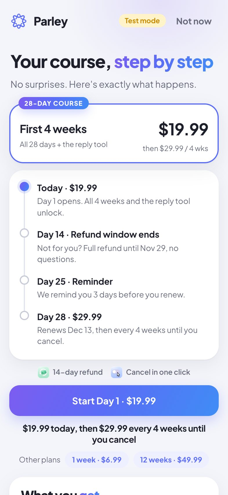</td>
<td>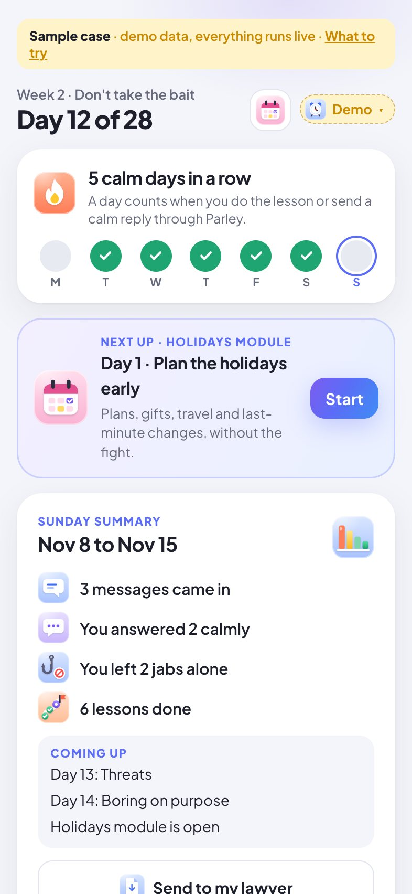</td>
</tr>
<tr>
<td>Their 28 days, four week themes, day 1 tonight</td>
<td>By day 28, this is how you reply</td>
<td>The price as a timeline: what is charged when, refund window, reminder</td>
<td>Course home: streak, next lesson, Sunday summary</td>
</tr>
</table>

| Plan | First period | Then |
|---|---|---|
| 1 week | $6.99 | $29.99 every 4 weeks |
| **4 weeks** (most picked) | **$19.99** | $29.99 every 4 weeks |
| 12 weeks | $49.99 | $69.99 every 12 weeks |

No free tier. 14-day refund, cancel in one click, a reminder 3 days before each renewal. Every paid API answers `402` without an active plan (one gate in `server/index.ts`).

## Why they keep paying: the case keeps going

<table>
<tr>
<td width="25%">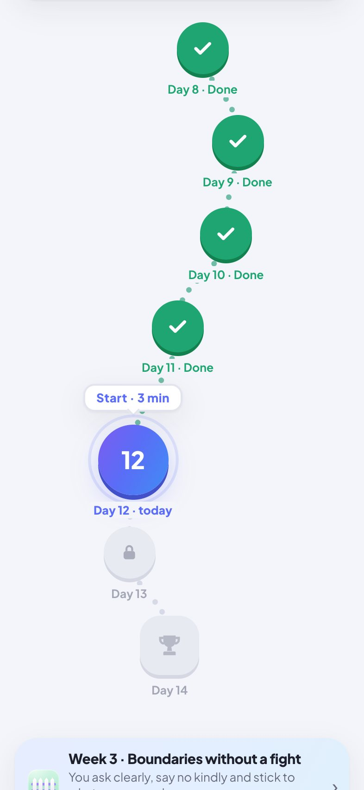</td>
<td width="25%">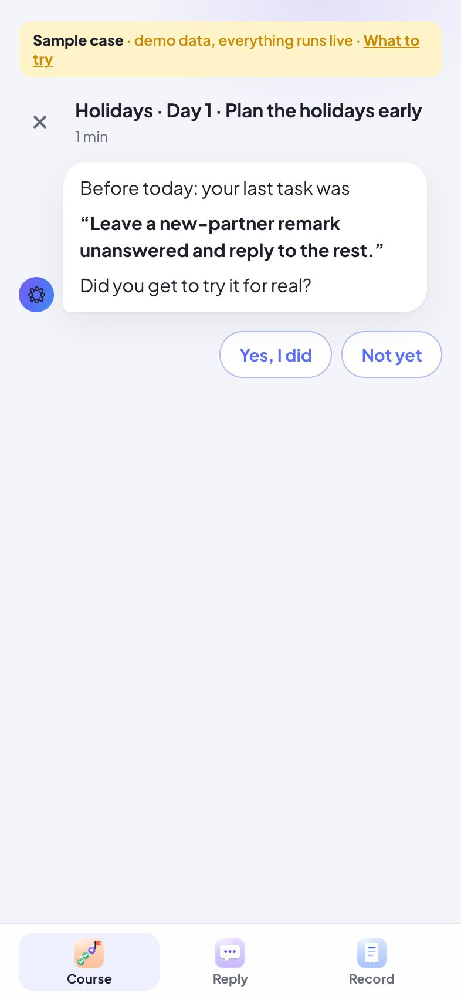</td>
<td width="25%">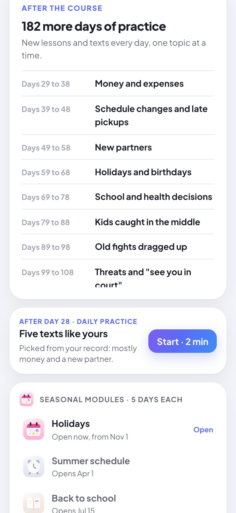</td>
<td width="25%">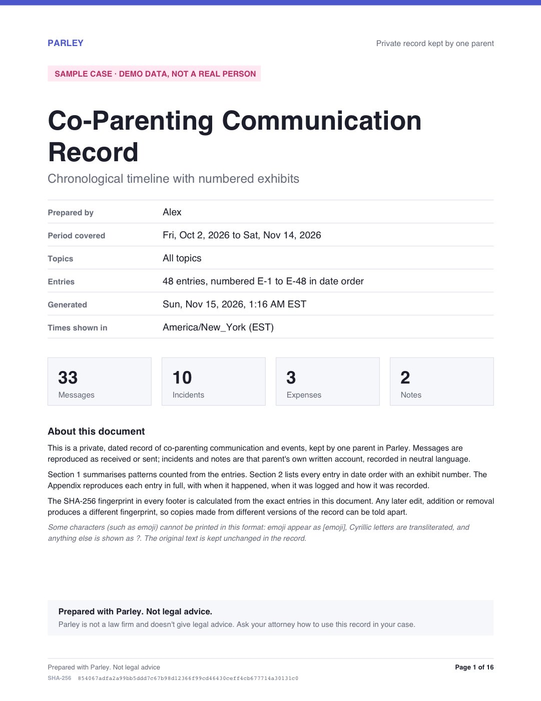</td>
</tr>
<tr>
<td>One day opens each day. Week badges.</td>
<td>Every lesson is a chat: a 1-minute idea, then practice on texts like their ex's</td>
<td>182 more days after the course, seasonal modules (holidays, summer, school, moving)</td>
<td>The record as one PDF for the lawyer, every message numbered</td>
</tr>
</table>

- **28-day course**, then **182 days of practice** by topic: money, schedule, new partner, kids, court.
- **Seasonal modules**: holidays, summer, back to school, moving, mediation.
- **Sunday summary**: the week in numbers and a PDF ready for the lawyer.
- **Calm-days streak**: a lesson or a calm real reply counts.

## When a real text comes in

<table>
<tr>
<td width="25%">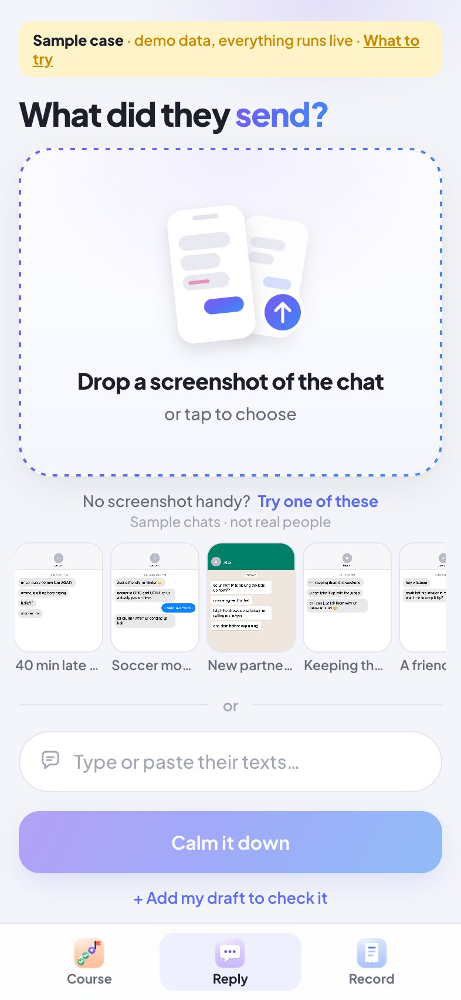</td>
<td width="25%">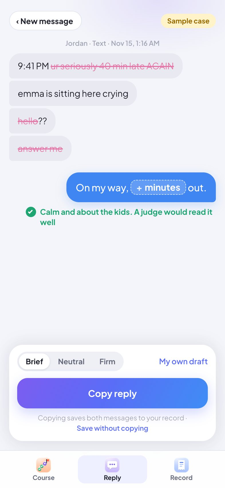</td>
<td width="25%">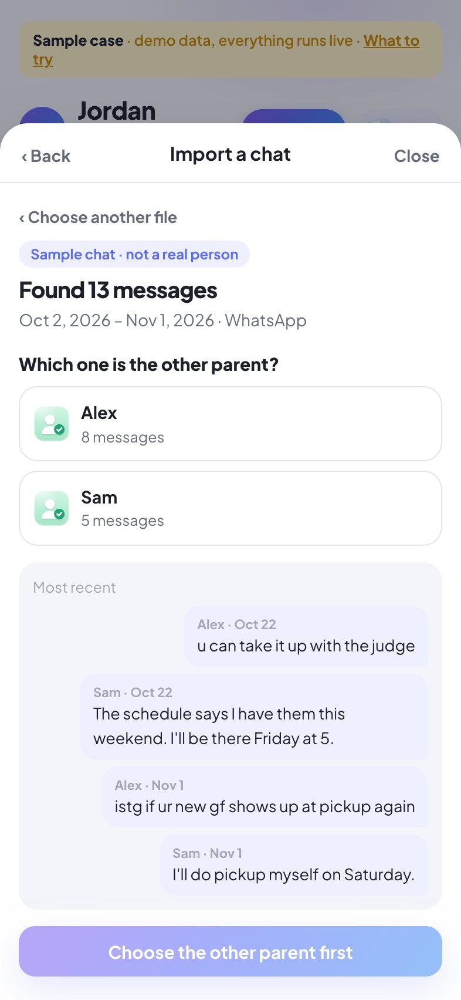</td>
<td width="25%">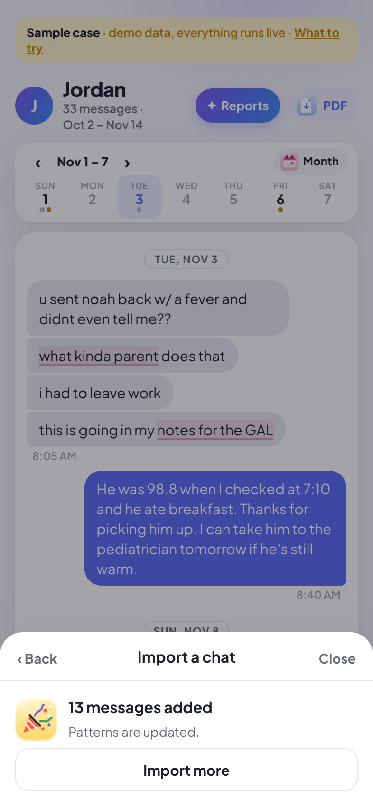</td>
</tr>
<tr>
<td>Drop their screenshot, or tap a sample</td>
<td>The bait is crossed out, the reply answers only what needs an answer. Brief, neutral or firm.</td>
<td>Import a WhatsApp export: pick which one is the other parent</td>
<td>Everything lands in the record, dated, and goes into the PDF</td>
</tr>
</table>

It works with one parent. The other parent never sees Parley, which is exactly where the big co-parenting apps fail: they record nothing if the ex won't join.

---

## The pitch in numbers

**Problem**
- **12.9M** custodial parents in the US (US Census P60-269)
- **663K** divorces a year (CDC/NCHS 2024, excludes 5 states)
- **$349** an hour, the average US lawyer (Clio Legal Trends 2025)

**Who we sell to:** a parent aged 30 to 45 in a custody fight. **1 to 2M** US families have a high-conflict ex (10 to 15% of separations, Johnston). They already pay a lawyer, and the lawyer tells them to "document everything".

**What they use today**

| | Price | Needs the other parent | Writes the reply | Record for court | Teaches the skill |
|---|---|---|---|---|---|
| OurFamilyWizard | $110 to $300 / year, each parent | Yes | Tone check on top tiers | Yes | No |
| TalkingParents | $77 to $352 / year | Yes | Top tier only | Yes | No |
| BestInterest | $10 to $30 / month | No | Yes | Partly | No |
| ChatGPT | $0 to $20 / month | No | Long and formal | No | No |
| **Parley** | **$19.99 first 4 weeks** | **No** | **Yes, in their texting voice** | **Yes, PDF** | **28-day course** |

**Marketing:** AI static ads, Zimran's playbook. Competitors run polished brand ads and no quiz funnels (OFW about 75 ads, TalkingParents about 43 in the Meta Ad Library). Plain-text ads win more often than polished ones on Meta (11.6% vs 7.0%, Motion 2026). #coparenting has 5B TikTok views.

**Unit economics, paid ads only**

| Step | Rate | Per 1,000 ad views |
|---|---|---|
| Ad views | CPM $15.06 | 1,000 ($15) |
| Click | 1.77% | 17.7 |
| Start the quiz | 55% | 9.7 |
| Finish it | 60% | 5.8 |
| See the price | 80% | 4.7 |
| Pay | 8% | 0.37 |

- **CAC $40**, **LTV $132** (after Stripe fees, refunds and AI cost), **3.3×**, paid back in about 2 months.
- Retention: 50% renew once, 89% stay each month after, about 5 paid months (RevenueCat 2025 says 61.7% renew once; we use 50% for a web intro price).
- Below average at every step it still gives 1.45×.

**Path to $100M ARR**

| When | Ad spend | ARR |
|---|---|---|
| Month 1 | $3K test, stop if CAC is over $100 | |
| Months 2 to 6 | $30K / month | $1.5M |
| Year 2 | $300K / month | $15M |
| Year 3 | $2M / month | $100M, 257K paying parents, 1% of 25M |

The model is in [`pitch/model.mjs`](pitch/model.mjs). Sources: Triple Whale (CPM), LocaliQ/WordStream 2026 Legal (CTR), Adapty 2025 (quiz steps), RevenueCat 2025 (renewals), each product's pricing page (November 2026).

---

## How it works

- **The AI part:** reading a screenshot, finding what needs an answer, writing the reply in three tones, reading your own draft like a judge would. Gemini 3.5 Flash with structured output (Claude as the fallback). Keys live only on the server.
- **Our code checks the model:** every flagged phrase must actually be in the text, invented numbers are rejected, the verdict is shown in words. `scripts/eval-reply.ts` runs 25 hostile messages through it and checks the rules.
- **Plain code, no AI:** the course, streaks, unlocks, renewals, the WhatsApp parser, the record and the PDF (exhibit numbers, a SHA-256 fingerprint on every page).
- **Privacy:** no account or email, a private cookie keeps the session. Download or delete everything in Settings.

**Stack:** Vite, React 18, TypeScript · Hono on Node 22 · SQLite (`node:sqlite`) · pdf-lib · one Hetzner VPS behind Caddy.

```
src/pages/funnel/   landing, quiz, plan, paywall, checkout
src/pages/app/      course, reply, record, settings
server/             API, AI calls, billing (test mode), PDF
server/course-content.ts, server/practice/   the 28 days and the 182 practice days
public/samples/     the sample screenshots and the WhatsApp export
```

## Run it locally

```bash
npm install
```

```bash
cp .env.example .env
```

Put a `GEMINI_API_KEY` (and `AI_PROVIDER=gemini`) or an `ANTHROPIC_API_KEY` in `.env`, then:

```bash
npm run dev
```

Web on :5173, API on :8787. Production: `npm run build && npm start`. Deploy: `deploy/deploy.sh`.

---

Parley is not a law firm and doesn't give legal advice. Sample chats and the sample case are made up.
